# Duvi로 공부하는 법 · 화면 따라 하기

> 2026-11-19, 이 PC의 Chrome에서 Duvi(main `0be5767`)를 실제로 조작하며 찍은 화면입니다.
> ChatGPT 연결은 하지 않은 상태라, 연결이 있어야 되는 기능은 **연결 후 가능**으로 표시했습니다.

## 먼저 비유 하나

Duvi는 **"자막이 두 줄 달린 강의실 + 내 공부 노트 + 복습 알람"** 이 한 화면에 붙어 있는 앱입니다.

- 강의실: MIT·YouTube 강의를 영어 자막(위)과 한국어 번역(아래)으로 봅니다.
- 노트: 막힌 순간 영상이 멈추고, 그 장면의 자막과 함께 내 질문·내 설명을 적어 둡니다.
- 복습 알람: 적어 둔 질문을 1/3/7일 뒤에 다시 꺼내 "내 말로 다시 설명"하게 합니다.

배우는 순서는 늘 같습니다. **보기 → 막히면 멈추고 묻기 → 내 말로 적기 → 며칠 뒤 다시 떠올리기.**

---

## 1. 첫 화면: 어디에 무엇이 있나

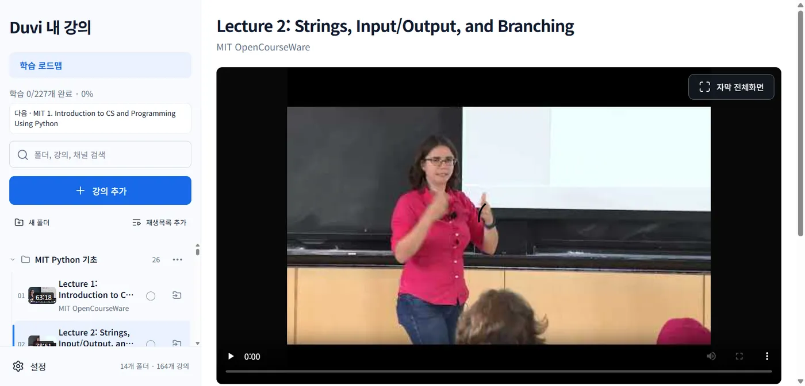

- **왼쪽 사이드바**: 내 강의 목록입니다. 폴더(예: MIT Python 기초) 안에 강의가 순서대로 있고, 동그라미(○)는 완료 표시입니다.
- **학습 로드맵**(왼쪽 위 파란 버튼): "오늘 무엇을 할지" 알려 주는 지도입니다.
- **다음 · MIT 1 ...** 카드: 다음에 볼 강의 바로가기입니다.
- **설정**(왼쪽 아래 톱니): ChatGPT 연결, 번역 방식, 단축키가 있습니다.

왜 중요한가: 무엇부터 볼지 고민하지 않아도 됩니다. 매번 **학습 로드맵**이나 **다음** 카드에서 시작하세요.

## 2. 학습 로드맵: 오늘 할 일과 완료 표시

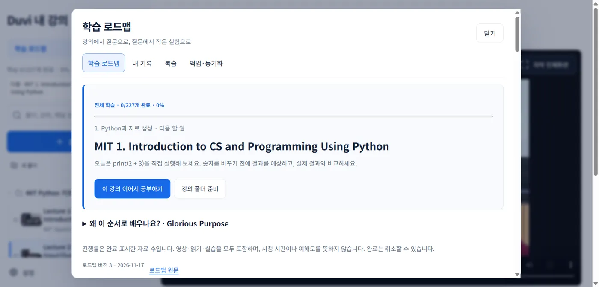

- 맨 위 카드가 **오늘의 첫 할 일**입니다: MIT 1강, 그리고 **print(2 + 3)을 실행하기 전에 결과를 먼저 예상**하는 것.
- **이 강의 이어서 공부하기**를 누르면 그 강의가 열립니다.

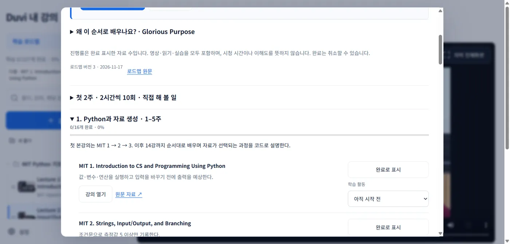

- 아래로 내리면 단계(예: **1. Python과 자료 생성 · 1–5주**)와 강의 목록이 있습니다.
- 강의마다 **완료로 표시**와 **학습 활동**(아직 시작 전 → 학습 중 → 직접 실습 중 → 내 말로 설명함 → 시간을 두고 적용함)이 있습니다.
- 진행률은 내가 완료로 표시한 개수일 뿐, 이해도를 뜻하지 않습니다. 완료는 다시 취소할 수 있습니다.

왜 중요한가: "봤다"와 "내 말로 설명할 수 있다"를 구분해 기록하는 것이 실력을 키웁니다. 학습 활동을 정직하게 올려 가세요.

## 3. 강의 보기: 영상, 영어 자막, 한국어 번역

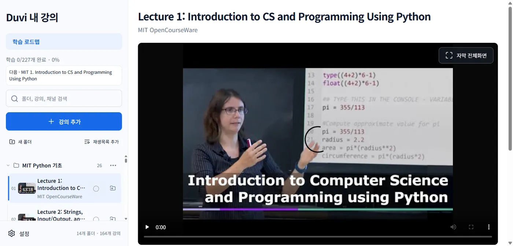
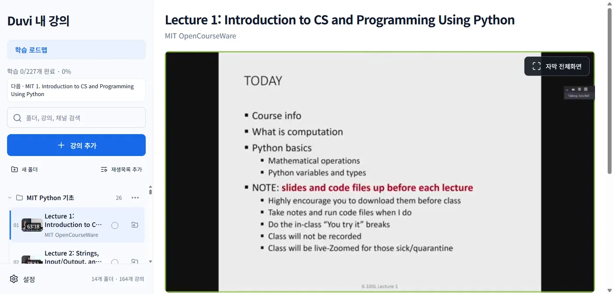

- 로드맵의 **강의 열기**로 MIT 1강이 열립니다. ▶로 재생합니다. (MIT 영상은 처음 몇 초간 불러오는 시간이 걸릴 수 있습니다.)

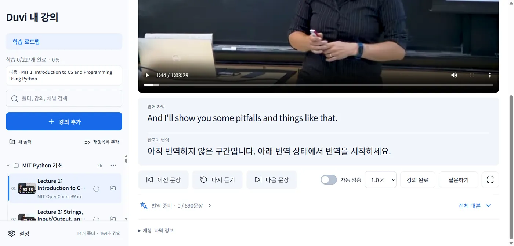

- 영상 아래에 **영어 자막**(지금 말하는 문장)과 **한국어 번역** 칸이 있습니다.
- **이전 문장 / 다시 듣기 / 다음 문장**: 한 문장씩 되돌려 듣습니다(키보드 ← R →).
- **자동 멈춤**을 켜면 문장마다 멈춰서 따라 읽기 좋습니다. 속도(0.75×~2×)도 바꿀 수 있습니다.
- **강의 완료**, **질문하기**, 전체화면 버튼이 같은 줄에 있습니다.
- 영상 바로 아래 **시각 띠**(2026-11-21 추가)에 이 강의에서 남긴 질문이 점으로 보입니다. ●는 내 설명을 적은 질문, ○는 아직 열린 질문입니다. 점을 누르면(또는 Tab으로 골라 Enter) 그 장면으로 가서 멈춥니다. 띠는 10분 구간을 보여 주고, 왼쪽 `00:00–10:00`에서 다른 구간을 고를 수 있습니다.

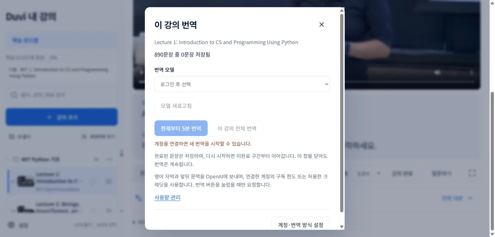

- 한국어 칸이 "아직 번역하지 않은 구간"이면, 아래 **번역 준비 · 0 / 890문장**을 눌러 번역 창을 엽니다.
- **현재부터 5분 번역** 또는 **이 강의 전체 번역**을 누릅니다. 한 번 번역한 문장은 저장되어 다음엔 로그인 없이 보입니다.
- 새 번역은 **연결 후 가능**: 이번엔 연결 전이라 "계정을 연결하면 새 번역을 시작할 수 있습니다"가 보입니다.

왜 중요한가: 처음엔 한국어로 뜻을 잡고, 익숙해지면 영어 문장을 먼저 읽고 한국어로 확인하세요. 영어 강의를 듣는 힘이 같이 자랍니다.

## 4. 설정: ChatGPT 연결(직접 로그인)

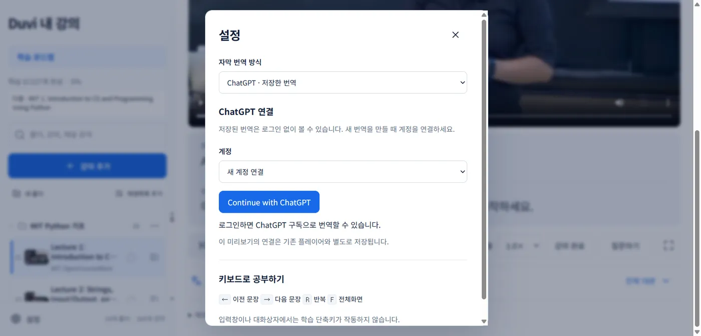

- 번역 창의 **계정·번역 방식 설정** 또는 왼쪽 아래 **설정**에서 엽니다.
- **Continue with ChatGPT**를 누르고 **본인이 직접** 로그인합니다. 로그인하면 ChatGPT 구독으로 번역하고 질문에 답을 받습니다.
- 이번 시연에서는 연결하지 않았습니다(로그인은 사용자 본인만 할 수 있습니다). **처음 공부를 시작하기 전에 한 번 연결해 두세요.**
- 아래 **키보드로 공부하기**: ← 이전 문장, → 다음 문장, R 반복, F 전체화면.

## 5. 질문하기: 막힌 순간 바로 묻기

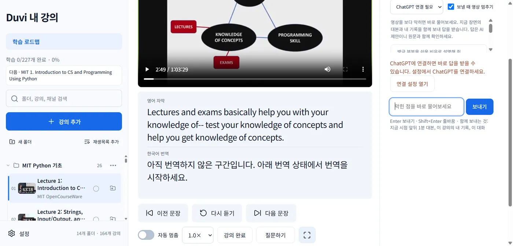

- 영상 아래 **질문하기**를 누르면 오른쪽에 **이 강의 · 시간순** 창이 열립니다(위 그림은 2026-11-19의 예전 모습, 새 모습은 아래). 이 강의에서 한 질문, AI 답, 내 설명이 **강의 시각 순서**로 한 줄에 보이고, 지금 보는 자리에 **지금 03:16** 같은 선이 있습니다.
- 위쪽 **전체 / 열린 질문 / 대본**: 열린 질문만 보거나, 대본 탭으로 바로 갑니다.
- 추천 질문(처음 한 번): "방금 부분을 쉬운 비유로 설명해 줘", "지금 코드가 한 줄씩 무슨 일을 하는지 알려 줘", "이 개념을 확인할 작은 문제 하나 내 줘".
- **질문을 쓰기 시작한 순간의 시각**이 입력창 위에 "00:30에서 질문 중"으로 잡힙니다. 영상이 더 흘러도 질문은 그 장면에 붙습니다. **×**를 누르면 시각을 떼고 보낼 때의 장면으로 보냅니다. 글을 다 지우면 시각도 사라집니다.
- 입력창 아래 **보낼 자료**: `02:12–04:12 대본`(그 시각 앞뒤 1분)과 `이 강의 내 노트 2`를 끄고 켤 수 있습니다. 끄면 실제로 보내지 않습니다. 이 대화의 앞선 질문과 답은 항상 함께 갑니다. **새 대화**를 켜면 다음 질문을 이전 대화와 따로 시작합니다.
- **보낼 때 멈추기**가 켜져 있으면, 질문을 **보내는 순간** 영상이 멈춥니다(창을 여는 것만으로는 멈추지 않습니다).
- 답 속 `03:16` 같은 시각에 마우스를 올리거나 Tab으로 고르면 **그 순간의 영어·한국어 문장**이 카드로 보입니다(Esc로 닫기). 누르면 그 장면으로 갑니다.
- 질문과 답 바로 아래 **내 설명 쓰기**에서 내 말로 적고 **저장**합니다. AI 답과 따로 내 기록으로 저장되고(아직 기록이 아니면 함께 만듭니다), AI 도움 정도를 고를 수 있으며, 시각 띠의 점이 ●로 바뀝니다. 적는 동안 새 답이 들어와도 쓰던 칸은 그 자리에 있고, **닫기**를 눌러도 쓴 내용은 남습니다.
- **연결 후 가능**: 실제 답변(글자가 바로 흘러나옴)과 **기록으로 저장**. 연결 전에는 "설정에서 ChatGPT를 연결하세요"가 보입니다.

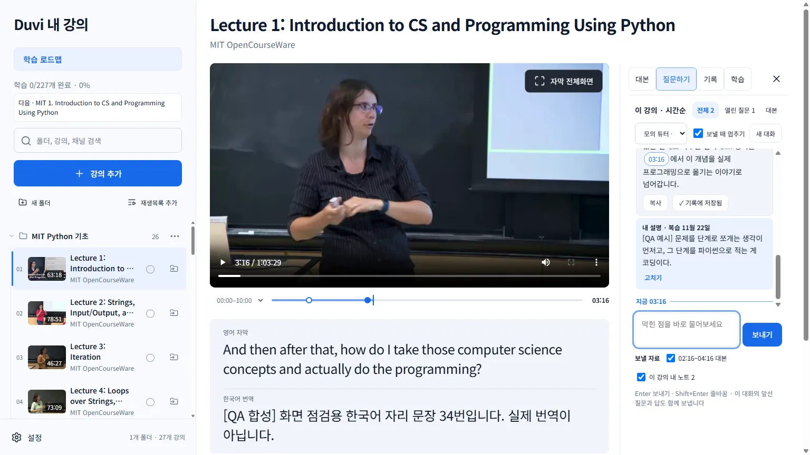
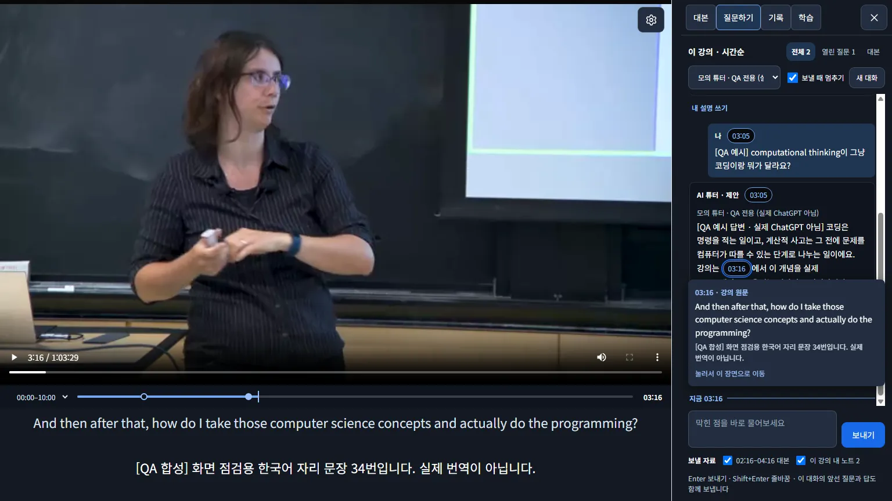
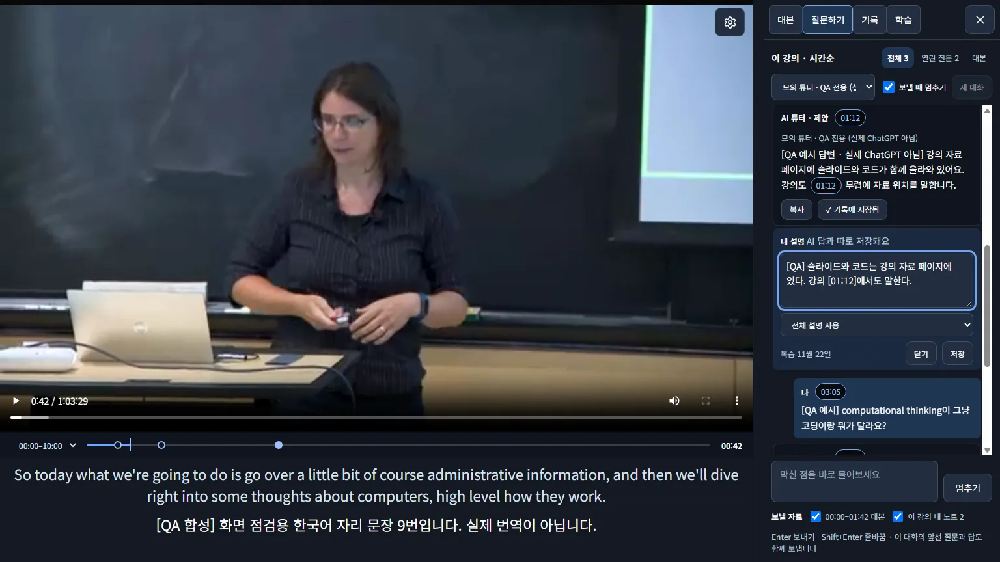

왜 중요한가: 막힌 채로 계속 보면 뒤가 다 흐려집니다. 그 자리에서 묻고, 답은 **AI 제안**이니 원문 자막과 맞춰 보세요.

## 6. 기록 → 내 기록 → 열린 질문 → 복습

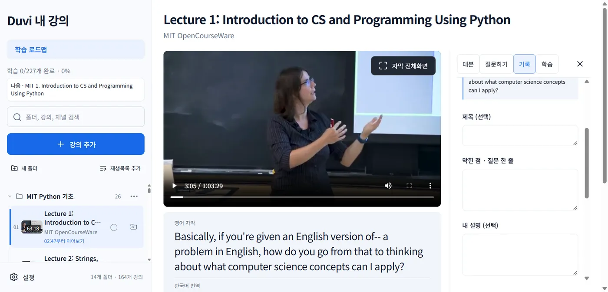

- 오른쪽 패널의 **기록** 탭을 열면 영상이 그 자리(이번엔 03:05)에서 **자동으로 멈추고**, 그 시점의 영어 원문이 붙습니다.
- **막힌 점 · 질문 한 줄**, **내 설명**을 적습니다. 처음엔 짧아도 됩니다.

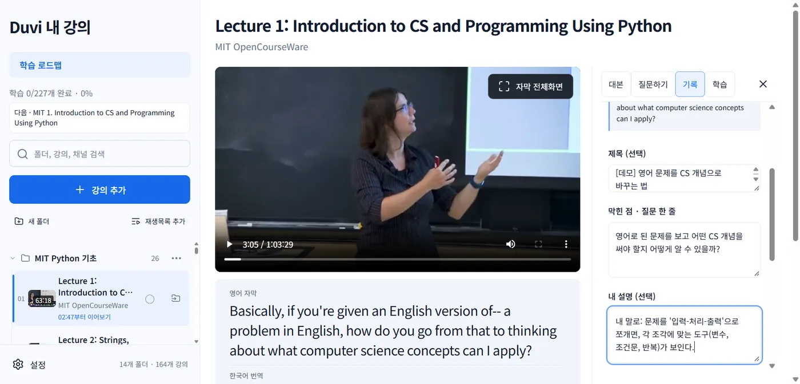
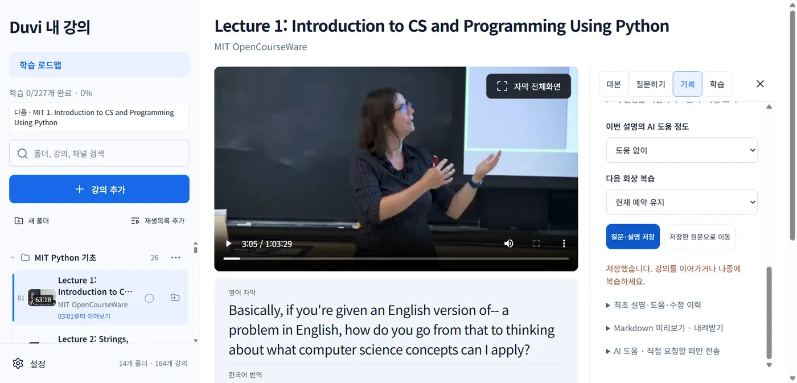

- **이번 설명의 AI 도움 정도**(도움 없이/힌트/부분/전체)와 **다음 회상 복습**(1/3/7일 뒤)을 고르고 **질문·설명 저장**을 누릅니다.
- 이 화면의 기록은 시연용이었고, 시연 후 지웠습니다.

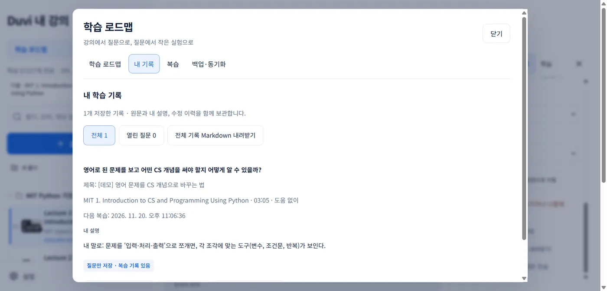
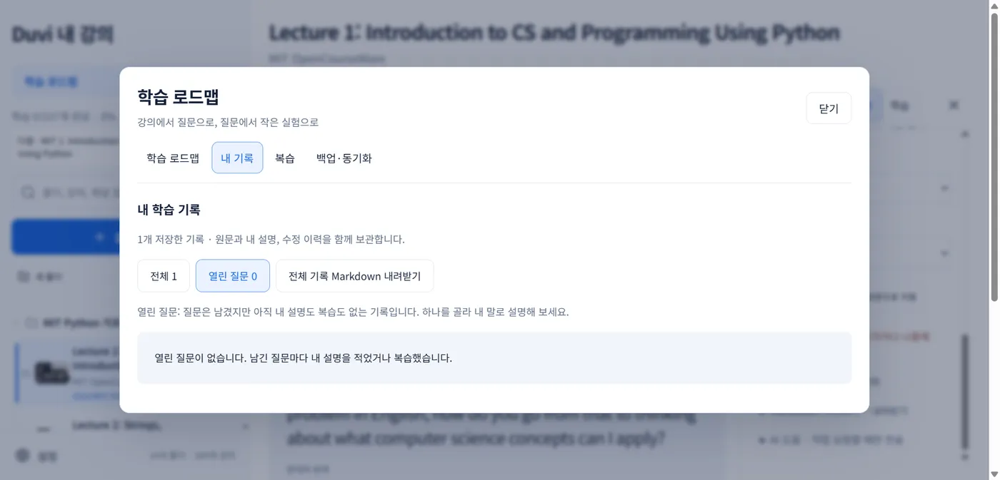

- 학습 로드맵 창의 **내 기록**에 저장한 기록이 쌓입니다. **전체 기록 Markdown 내려받기**로 한 파일로 받을 수 있습니다.
- **열린 질문**은 질문만 있고 아직 **내 설명도 복습도 없는** 기록만 보여 줍니다. 여기 남은 것이 "아직 이해 못 한 것" 목록입니다.

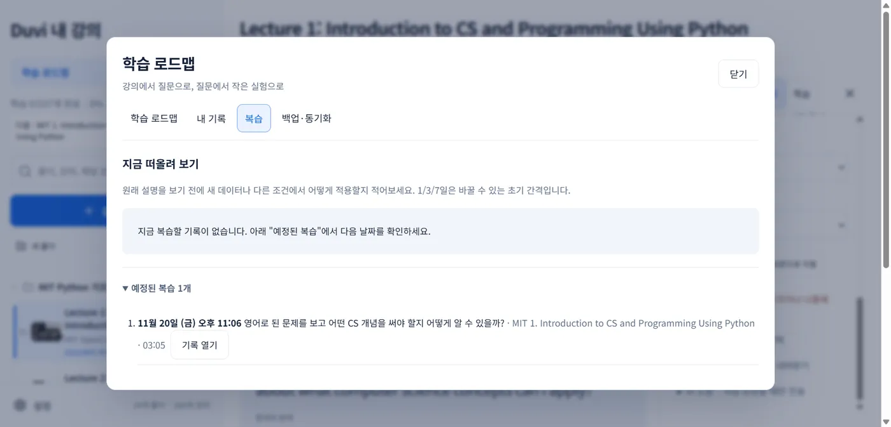

- **복습**의 **지금 떠올려 보기**: 원래 설명을 보기 전에, 다른 조건에서는 어떻게 적용할지 먼저 적어 봅니다.
- **예정된 복습**: 앞으로 떠올릴 날짜가 날짜순으로 있습니다.

왜 중요한가: 사람은 "다시 떠올리려고 애쓸 때" 가장 오래 기억합니다. 열린 질문을 0으로, 예정된 복습은 그날그날 처리하세요.

## 7. 전체화면: 영상 + 자막 + 대화·노트 한 화면

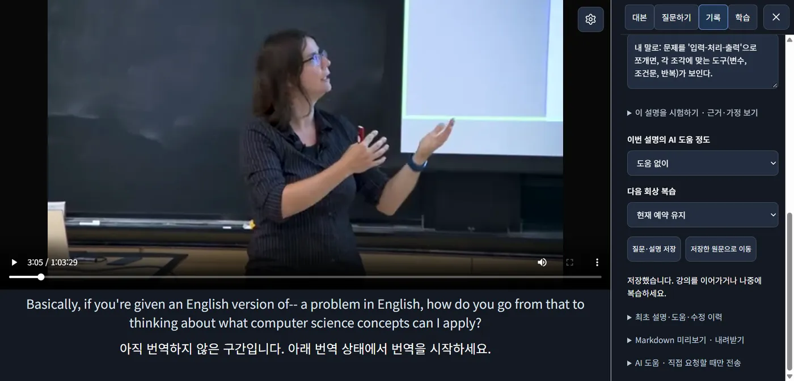

- 영상 아래 전체화면 버튼(또는 영상 위 **자막 전체화면**, 키보드 F)을 누르면 영상과 두 줄 자막이 화면을 채우고, 오른쪽에 패널이 붙습니다.

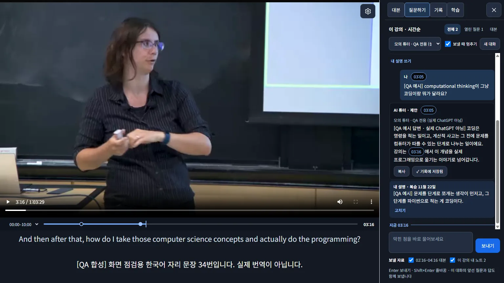
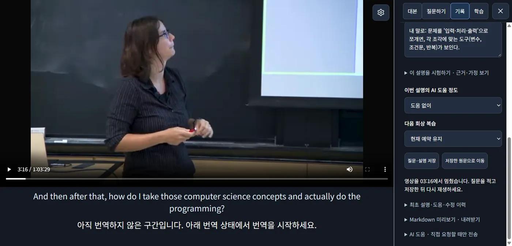

- 전체화면 안에서도 **질문하기**와 **기록** 탭을 그대로 씁니다. 기록 탭을 열자 03:16에서 자동으로 멈췄습니다.

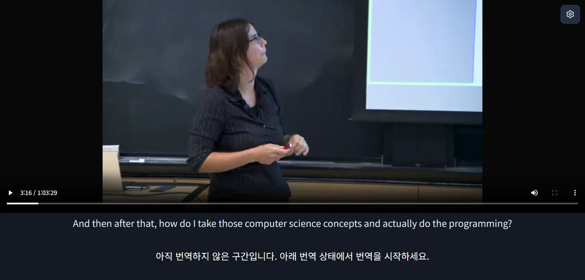
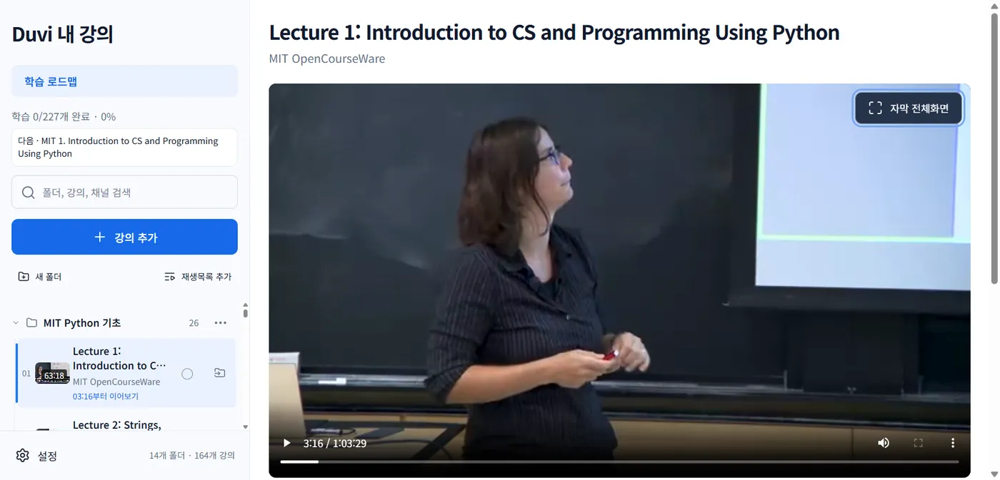

- 패널을 닫으면 영상과 자막만 남습니다. **Esc**를 누르면 원래 화면으로 돌아옵니다(이번에 실제 Esc 키로 확인).
- 확인 범위: 2026-11-19 시연(17·19·20·21번 그림)은 자동화용 Chrome 창에서 해서 **창 전체를 채우는 Duvi 전체화면 모드**였습니다. 2026-11-21 그림(시간순 패널)은 전체화면 버튼을 실제로 눌러 브라우저 전체화면(`document.fullscreenElement`가 강의 화면)이 된 상태에서 찍었고, 크기는 1536×864·1280×720으로 맞춘 화면입니다.

왜 중요한가: 오래 집중할 때는 이 화면 하나만 쓰면 됩니다. 보면서 묻고, 바로 적고, 계속 봅니다.

## 8. 백업·동기화: 여러 PC에서 이어 공부하기

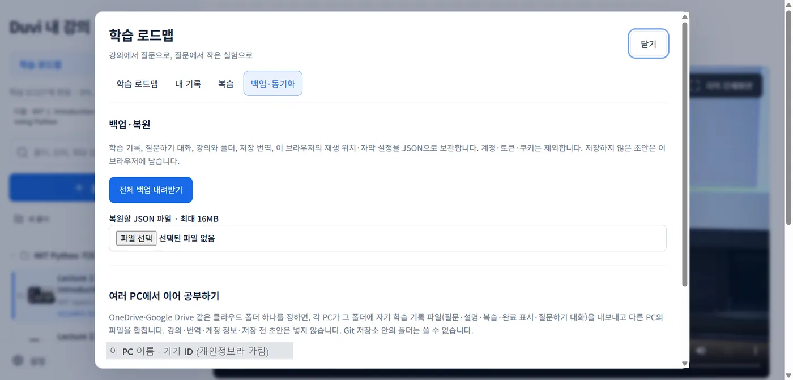
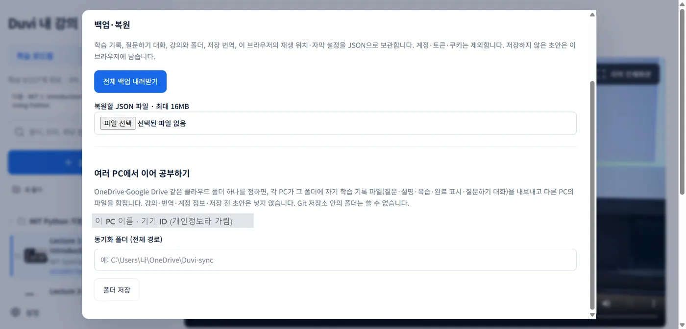

- **전체 백업 내려받기**: 학습 기록·대화·강의·번역·재생 위치를 JSON 한 파일로 저장합니다(계정·토큰·쿠키 제외). **복원할 JSON 파일**로 되돌립니다.
- **여러 PC에서 이어 공부하기**: OneDrive·Google Drive 같은 클라우드 폴더 하나를 **모든 PC에서 같은 곳으로** 정하고 **폴더 저장**을 누릅니다. 각 PC가 자기 학습 기록 파일을 내보내고, 다른 PC의 파일은 미리보기로 확인한 뒤 합칩니다.
- 합칠 때 지워지는 기록은 없습니다. 두 PC에서 같은 기록을 고쳤다면 나중 것이 현재 값, 다른 쪽은 수정 이력에 남습니다. Git 저장소 안의 폴더는 쓸 수 없습니다.
- 자세한 설계: [여러 기기에서 이어 가기](MULTI_DEVICE_SYNC.md).

왜 중요한가: PC를 옮겨도 질문·설명·복습 일정이 이어져야 복습이 끊기지 않습니다. 공부를 시작·마칠 때 동기화하는 습관을 들이세요.

**예전에 합친 대화에서 질문과 답이 맞지 않을 때**

2026년 11월 21일 수정 전에 두 PC에서 같은 대화에 각각 질문한 뒤 합쳤다면 답이 다른 질문 아래에 보일 수 있습니다. 당시 파일에는 답이 어느 질문에 딸렸는지 알려 주는 번호가 없어서, 이미 섞인 대화의 짝을 안전하게 복원할 수 없습니다. 현재 전체 백업을 먼저 보관하고, 합치기 전 백업이 있다면 원래 대화를 대조한 뒤 학습 기록을 남기세요. 새 버전끼리 합치면 각 PC의 질문과 답이 함께 이동합니다.

---

## 일주일 공부 루틴 (10–12시간)

1. **주 5회 × 2시간**: 로드맵 **다음 할 일**부터. 강의 40–60분 보기(자동 멈춤 켜고, 막히면 질문하기/기록) + 30–40분 직접 코드 실행(예: 실행 전에 결과를 먼저 예상).
2. **매 회차 시작 10분**: **복습 → 지금 떠올려 보기**와 **예정된 복습**부터 처리합니다.
3. **매 회차 끝 10분**: **열린 질문**을 하나 골라 **내 설명**을 적고, 로드맵의 학습 활동을 정직하게 올립니다.
4. **주말 1–2시간**: 이번 주 기록을 **Markdown으로 내려받아** 다시 읽고, 가장 헷갈린 개념 하나를 작은 실험 코드로 확인합니다.
5. **PC를 바꿀 때마다**: **백업·동기화**에서 내보내기·합치기를 하고, 한 달에 한 번 **전체 백업**을 받아 둡니다.
