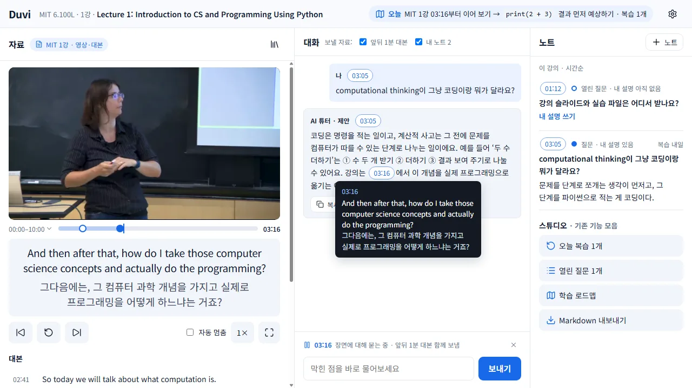
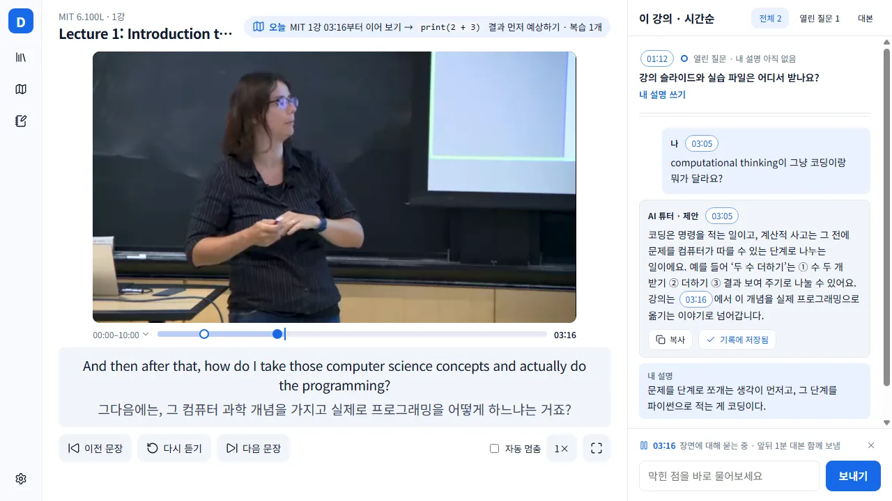
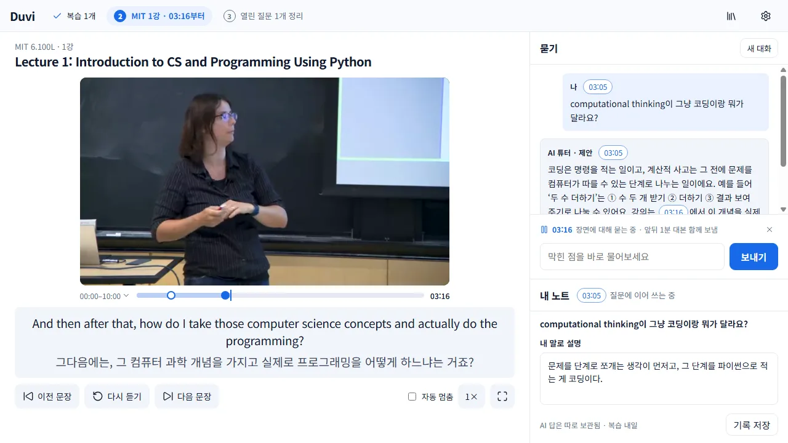

# Duvi 사용자 과업 기반 UI 설계 · 노트북형 재구성 검토

작성일: 2026-11-19. 범위: **설계**(task-first-frontend 1–6단계). 구현(7–8단계)은 사용자가 시안을 고른 뒤에만 한다.

사용자 요청(2026-11-19): "llm note 북처럼 ui 구성하면 안되니? 너 내가 만든 스킬 안 썼지 쓰면 이렇게 나오나?"
— Google NotebookLM처럼 자료·대화·노트를 한 화면에 두는 구성을 검토하고, 사용자가 만든 `task-first-frontend` 스킬 절차를 그대로 따르라는 요청으로 읽었다.

핵심 과업은 **영어 강의를 보다 막힌 순간, 영상과 두 줄 자막을 놓치지 않은 채 묻고, 답을 근거 장면과 맞춰 보고, 그 자리에서 내 말로 설명을 적는 것**이다. 성공하면 강의 시간에 고정된 질문·AI 제안·내 설명이 한 기록으로 남고, 다음 회차에 열린 질문과 복습으로 다시 나타난다.

> 상태: 1–6단계 완료, **시안 선택 대기**. 구현(7–8단계)은 하지 않았다.

## 기준과 권한 (1단계)

- 저장소/지침: github.com/hyperdrivebeep/duvi, `AGENTS.md`, `DESIGN.md`(§8 전체화면, §12 사이드 채팅).
- 코드 기준: 원격 `origin/main` = **`b9e32be`** (2026-11-19 `git fetch`로 확인). 이 PC에 설치해 쓰는 checkout(저장소 밖 로컬 사본)은 `0be5767`(한 커밋 뒤, 차이는 문서 `docs/study-walkthrough`뿐)이라 UI 코드는 동일. 설계는 별도 worktree(`b9e32be`)에서 읽었다.
- dirty/동시 작업: 설치본 checkout은 손대지 않았다. 실행 중인 6103 서버는 멈추지 않았고 학습 상태를 바꾸지 않았다.
- 현행 화면 출처: 2026-11-19 `0be5767` 설치본을 Chrome에서 조작한 캡처 23장(저장소 밖 로컬 작업 폴더, 1733×833 등) + 저장소 `docs/qa-evidence/`. 설계에 쓴 UI 코드는 두 커밋에서 동일하므로 캡처를 현행 근거로 쓴다.
- 승인 범위: 설계·시안·브리프 작성, 브리프와 시안 이미지(WebP)를 `docs/design/2026-11-19-notebook-ui/`에 commit/push(사용자 승인). 제품 코드 변경 없음. 데스크톱만.
- 자료 성격: 강의 영상 장면은 MIT OpenCourseWare(CC BY-NC-SA 4.0) 실제 캡처. 03:16 영어 자막 한 줄은 실제 캡처 문장. 한국어 번역·다른 대본 문장·AI 답변·노트 내용은 **시안용 예시**(ChatGPT 미연결 상태라 실제 답변은 관찰하지 않음).

## 코드와 상태 연결 (2단계)

| 정상 진입 | 화면/행동 | handler/API | 상태 소유자 | 결과 소비자 | 코드 근거 |
| --- | --- | --- | --- | --- | --- |
| `index.html` → `src/app.mjs` | 사이드바 **학습 로드맵** / **다음 · MIT 1** | `LearningUI.open('roadmap')`, `GET /api/learning/roadmap` | 서버 로드맵 + `state.progress` | 로드맵 모달, 사이드바 `학습 n/227` | `learning-ui.mjs` `open`,`sync`; `learning-map-view.mjs` |
| 강의 행 클릭 | 영상 + 영어/한국어 자막 | `GET /api/lectures/:id`, `/api/translations/:id` | 강의 데이터 + 번역 캐시 | `.captions`, 대본 `.cue` | `app.mjs` `load` (63행), `study-view.mjs` |
| 툴바 **질문하기** | 오른쪽 패널 `질문하기` 탭 | `POST /api/learning/chat`(스트림), `/chat/stop`, `/chat/models` | `state.chats`(강의별 대화) | 메시지 로그, 시간 칩 → seek | `learning-chat.mjs` `send`,`onEvent`,`chip` |
| 답변 **기록으로 저장** | 기록 생성 | `POST /api/learning/chat/record` | `state.records`(aiAnswer 분리) | 열린 질문, 내일 복습 | `learning-chat.mjs` `saveRecord` |
| 패널 **기록** 탭 | 자동 멈춤 + 원문 앵커 + 질문/내 설명 | `POST /api/learning/records`(recordRevision) | `state.records` | 내 기록, 복습 | `learning-ui.mjs` `question`,`saveRecord`; `learning-editor.mjs` |
| 로드맵 모달 **내 기록 / 복습** | 목록·필터·회상 | `POST /api/learning/review` | `records[].reviewDueAt` | 예정된 복습 | `learning-records-view.mjs` |
| 전체화면(F) | 영상·자막 dock + 오른쪽 320px 패널 | `setupStudyView.enter` | DOM 클래스 `study-focus`, `has-transcript` | 같은 4탭 패널 | `study-view.mjs`, `study-view.css` |
| 백업·동기화 | 내보내기/미리보기/합치기 | `/api/learning/sync/*`, `/import*` | 학습 상태 파일 | 다른 PC | `learning-sync-ui.mjs` |

중요한 구조 사실: 오른쪽 패널은 **한 번에 탭 하나**(`selectTab`이 다른 `data-stage-panel`을 모두 `hidden`)다. 그래서 `질문하기`의 답과 `기록`의 내 설명 입력을 동시에 볼 수 없다. 내 기록·복습·로드맵은 영상 위를 덮는 **모달**(`learningDialog`)에 있다. 채팅 질문은 이미 재생 시점(`seconds`)과 ±1분 대본을 함께 보낸다(`send` → `/api/learning/chat`, 힌트 문구 `chat-context`).

### 디자인 토큰(최종 적용 순서: `library.css` → `study-view.css` → `learning.css`)

파랑 `#1769e8`, 보조 글자 `#617088`, 선 `#e5eaf1`, 부드러운 면 `#f2f5fa`, 사이드바 `#f8fafd`, 선택 `#eaf2ff`, 글자 `#111a2d`, 포커스 `#75a6f0`, 알림 `#8b3d24`. 전체화면 어두운 면 `#090b10 / #141922 / #203652 / #232e40`, 자막 영어 `#dce3ee`·한국어 `#fff` 22px. 글꼴 Noto Sans KR Variable, 본문 14–15px, 보조 12px. 간격 4/8/12/16/20/24, 모서리 6–9px, 버튼 44px, 아이콘 lucide.

## 사용자 과업 (2단계, 코드·문서 기반 가설 — 인터뷰 아님)

| 상황 | 목적 | 필요한 정보 | 주 행동 | 완료 조건 | 근거/가정 |
| --- | --- | --- | --- | --- | --- |
| 회차 시작 | 오늘 할 일 고르기 | 다음 강의·이어볼 위치, 오늘 복습 수 | 오늘 할 일 열기 | 맞는 강의가 이어볼 위치에서 열림 | `nextResource`, 로드맵 hero / 주 10–12h 가정 |
| 시청 중 | 영어 강의 뜻 잡기 | 영어 문장 + 한국어 번역, 이전/다시/다음 | 문장 이동·반복 | 현재 문장을 두 언어로 이해 | §8, 캡처 06·17 |
| 막힌 순간 | 그 자리에서 묻기 | 지금 시점, 보내는 맥락(±1분 대본, 내 기록) | 질문 보내기(자동 멈춤) | 답을 받고 근거 시각으로 이동해 원문과 대조 | `learning-chat.mjs`, 캡처 18 |
| 답을 읽은 뒤 | 내 말로 적기 | AI 답(제안 표시), 원문 앵커 | 내 설명 저장 | 질문·내 설명이 시각에 고정된 기록으로 저장 | `learning-editor.mjs`, 캡처 11–13·19 |
| 회차 끝/다음 날 | 열린 질문·복습 | 설명 없는 질문, 예정 복습 | 떠올려 보기 후 저장 | 열린 질문 감소, 다음 복습 날짜 지정 | `learning-records-view.mjs`, 캡처 14–16 |
| PC 이동 | 이어서 공부 | 동기화 폴더 상태 | 내보내기/합치기 | 다른 PC에 같은 기록 | `learning-sync-ui.mjs`, 캡처 22–23 |

미확인 가정: 실제 사용 빈도, 질문 길이, 노트를 영상 중에 쓰는지 끝나고 쓰는지, 1280 노트북과 1536 이상 모니터 중 주 사용 화면.

## 현행 화면 관찰 (3단계)

새 캡처 없이 2026-11-19 캡처를 사용했다(23단계가 전 과업을 덮음). 전체화면은 자동화 Chrome에서 창 채움 대체 모드로 찍혔다(실제 모니터 전체화면 미확인).

| 캡처 | 과업 | 장점 | 문제 | 사용자 영향 | 개선 가설 |
| --- | --- | --- | --- | --- | --- |
| 05-playing | 시청 | 영상이 넓다 | 1733×833에서 자막·툴바가 첫 화면 아래로 밀림 | 일반 모드에서는 스크롤해야 자막을 봄 | 일반 모드도 영상+자막을 한 화면에 |
| 18-fullscreen-chat | 묻기 | 영상·자막·채팅 동시 표시, 자동 멈춤 | 4탭 중 하나만 보임, 상단 설정 2줄이 대화 공간 차지 | 답을 보며 내 설명을 쓸 수 없음 | 대화와 노트를 동시에 |
| 19-fullscreen-record | 적기 | 원문 앵커·자동 멈춤 | 긴 폼(도움 정도, 복습, 접힌 4개)이 320px에 세로로 쌓임 | 저장 버튼이 스크롤 아래 | 짧은 노트 + 세부는 나중에 |
| 14-my-records-list | 다시 보기 | 원문·설명·복습 함께 보관 | 모달이 영상을 가림, 강의와 분리 | 기록 보며 해당 장면 재생 불가 | 노트를 강의 옆 상시 영역으로 |
| 02/03-roadmap | 오늘 할 일 | 첫 할 일이 명확 | 모달, 강의 화면과 따로 | 강의 중 '오늘 할 일' 확인에 모달 왕복 | 오늘 할 일을 강의 화면에 상주 |
| 09-ask-panel | 묻기(일반 모드) | 시작 질문 3개 | 질문 버블의 시각 칩은 있으나 보내는 대본 범위는 문장 힌트로만 | 무엇이 근거로 갔는지 안 보임 | 보낸 시점·±60초 범위를 칩으로 보이기 |

한계: 캡처는 한 세션 관찰이며 사람 사용성 시험이 아니다. 대비비·키보드 동작은 스크린샷으로 인증하지 않았다.

## 레퍼런스 적용 (4단계, 확인일 2026-11-19)

사용자 가이드 2개(Google Drive `1uibapms…`, `1VRYj…`)는 로그인 요구로 **열지 못했다**. 스킬 본문의 요약표(증거 유형 먼저, 공식 문서 우선)를 따랐다. Mobbin 등 로그인 사이트는 보지 않았다.

| 출처 | 근거 유형 | 관찰 원리 | 적용 가설 | 가져오지 않을 것 | 확인 수준 |
| --- | --- | --- | --- | --- | --- |
| [Google 블로그 2024-12 재설계](https://blog.google/innovation-and-ai/models-and-research/google-labs/notebooklm-new-features-december-2024/) | 공식 설명 | Sources / Chat / Studio 세 영역, 소스 뷰어와 노트 편집기를 나란히 펼침 | 강의(자료)·대화·노트를 동시에 두면 탭 전환 없이 답을 보며 적음 | Studio의 원클릭 생성물(오디오 요약 등) — Duvi 원칙상 AI는 명시 요청·제안 표시 | 공식 설명, 직접 사용 안 함 |
| [NotebookLM(현 Gemini Notebook) 채팅 도움말](https://support.google.com/notebooklm/answer/16179559?hl=en) | 공식 문서 | 답변 인용 칩 → 선택 시 원문 위치로 이동, 답에 쓸 소스 선택, Save to note | `[mm:ss]` 칩 → 영상 seek(이미 있음)을 모든 시안에 유지, 보낸 맥락(시점·±60초·내 기록)을 선택 가능하게 표시 | "소스만으로 답" 제한 — Duvi 튜터는 일반 설명도 허용 | 공식 문서 |
| [노트 도움말](https://support.google.com/notebooklm/answer/16262519?hl=en) | 공식 문서 | 노트가 소스 패널에 함께 나타나 다음 질문의 근거가 됨, 저장한 답은 인용 제거 후 편집 | 내 기록을 다음 질문 맥락으로(이미 '이 강의의 내 기록' 전송) 보이게 | 저장한 AI 답을 내 설명으로 바꿔 쓰기 — Duvi는 aiAnswer와 내 설명을 분리 | 공식 문서 |
| [Google 블로그 2023-12 noteboard](https://blog.google/innovation-and-ai/products/notebooklm-new-features-availability/) | 공식 설명 | 채팅 인용·원문 발췌·내 메모를 한 noteboard에 핀 | 질문·답·내 설명을 한 노트 흐름으로 | 자동 요약 제안 | 공식 설명 |
| [Coursera 지원 커뮤니티 답변](https://www.coursera.support/s/question/0D51U00003BlYjLSAV/how-do-you-take-notes?language=en_US) | 커뮤니티 설명(검색 요약) | 영상 아래 Save Note(시각 고정), 대본 구간 선택 → Save Note | 대본 문장에서 바로 노트 시작 | 화면 캡처 노트 | 낮음 — 페이지가 JS 렌더라 본문 미확인 |
| [Language Reactor 내보내기 도움말](https://www.languagereactor.com/help/export) | 공식 문서(검색 요약) | 자막 단어를 표시하면 그 문맥 문장과 함께 저장 | 자막 문장에서 저장할 때 영어·한국어 문장 쌍을 함께 | 단어장·플래시카드 기능 | 낮음 — 본문 JS 렌더 |

### 4-2. 질문·기록을 영상 시각에 묶는 패턴 (moment-anchored questions/notes)

사용자 질문(2026-11-19): "질문 말풍선마다 `12:34` 같은 시각을 달고, 이런 유사한 기능은 어떻게 넣고 ui 어떻게 조직했는지 알아볼 수 있어?"

**이미 있는 것**: Duvi는 질문·답변 말풍선마다 재생 시각 칩을 이미 보여 주고, 누르면 그 시각으로 이동한다(`src/learning-chat.mjs` 70행 `chip`, 증거 `docs/qa-evidence/2026-11-19-side-chat/08-fs1536-streaming.webp`의 "나 10:17"). 답 안의 `[mm:ss]`도 칩이 된다. 그래서 아래 조사는 **없는 것**을 찾는 데 썼다: 진행 막대 위 질문 표시, 강의별 시각순 질문 목록, 시각을 잡는 순간, 칩을 눌렀을 때의 동작.

근거 수준: **공식 문서**(이번에 본문을 읽음) / **공개 화면**(본문 일부) / **추정**(본문을 열지 못함 — 2026-11-19~20 검색 API 한도 초과·도움말 사이트 시간 초과·403/404. 제품 일반 지식에 기댄 기술이며 현재 동작으로 단정하지 않는다).

| 제품 · 출처 | 근거 | 시각을 잡는 순간 / 수정 | 시각이 보이는 곳 | 클릭하면 | 묶음·필터 | Duvi 적용 가설 | 가져오지 않을 것 |
| --- | --- | --- | --- | --- | --- | --- | --- |
| Udemy 강의 노트 · [도움말 229603868](https://success.udemy.com/s/article/229603868?language=en-US) | 추정(JS 렌더라 본문 미확인) | 노트 입력을 **시작할 때** 현재 재생 시각을 잡는 것으로 알려짐, 시각 수정 불가 | 노트 목록 항목 앞 시각 | 해당 강의·시각으로 이동 | 현재 강의 / 모든 강의, 정렬 | 질문 입력을 시작하는 순간 시각을 잡아 "막힌 장면"을 정확히 남김 | 강의 밖 별도 노트 탭(영상과 분리) |
| Coursera 노트 · [지원 커뮤니티](https://www.coursera.support/s/question/0D51U00003BlYjLSAV/how-do-you-take-notes?language=en_US) | 공개 화면(검색 요약; 본문 JS) | 영상 아래 **Save Note** 누를 때 / 대본 구간 선택 후 Save Note | 노트 카드의 시각 | 영상의 그 지점 | 강의 주차별 노트 모음 | 대본 문장에서 바로 질문 시작(문장 시각 = 앵커) | 화면 캡처 이미지 노트 |
| Frame.io 댓글 · help.frame.io | 추정(시간 초과·403) | 댓글을 **쓰기 시작할 때** 현재 프레임/시각 고정, 구간 지정 가능 | 댓글 옆 타임코드 + **타임라인 위 마커** | 그 프레임으로 이동하고 멈춤 | 완료/미완료, 작성자 | 진행 막대 위 질문 마커, 클릭 시 이동+멈춤 | 프레임 단위 정밀도, 협업자·승인 흐름 |
| Loom 댓글·반응 · support.atlassian.com/loom | 추정(404) | 댓글 작성 시 현재 시각 첨부(선택 해제 가능한 것으로 알려짐) | 댓글 시각 + 진행 막대 위 반응/댓글 표시 | 그 시각으로 이동 | 시간순 댓글 목록 | 시각 첨부를 끌 수 있게(일반 질문) | 이모지 반응, 공개 공유 |
| YouTube 챕터·시각 링크 · [챕터 도움말 9884579](https://support.google.com/youtube/answer/9884579?hl=en) | 추정(페이지 200이나 본문 추출 실패) | 작성자가 설명란에 `00:00` 목록을 씀 / 공유 시 "시작 시각" 체크 | 진행 막대를 **구간으로 나눔**, 설명·댓글의 시각 링크 | 그 시각으로 이동(재생 유지) | 챕터 순서 | 진행 막대에 강의 구간(대본 기준) 위에 내 질문 점을 겹침 | 작성자 수동 챕터 작성 |
| NotebookLM(현 Gemini Notebook) · [채팅 도움말](https://support.google.com/notebooklm/answer/16179559?hl=en), [노트 도움말](https://support.google.com/notebooklm/answer/16262519?hl=en) | **공식 문서** | 답이 생성될 때 인용 자동 생성 | 답 본문의 **번호 인용 칩**, 마우스를 올리면 인용 원문 | 원문의 그 위치로 이동해 맥락 표시 | 소스 선택, 노트가 소스 패널에 함께 | 답의 `[mm:ss]` 칩(이미 있음)에 마우스를 올리면 그 시각 영어/한국어 문장 미리보기 | "소스만으로 답" 제한, Studio 자동 생성물 |
| Language Reactor · [내보내기 도움말](https://www.languagereactor.com/help/export) | 공개 화면(검색 요약; 본문 JS) | 자막 단어를 **표시할 때** 그 문장 문맥과 함께 저장 | 저장 목록의 문맥 문장 | 원 영상 문장으로 이동(추정) | 단어/문장, 언어 | 질문을 저장할 때 영어·한국어 문장 쌍을 앵커로 같이 | 단어장·플래시카드 |
| Snipd · [snipd.com](https://www.snipd.com/) | **공식 사이트** | 헤드폰 **세 번 탭** 순간 앞부분 구간을 잘라 저장, AI가 대본·요약 생성 | 에피소드의 snip 목록(대본·요약) | 그 구간 재생 | 에피소드별 snip, 노트 앱 내보내기 | "지금 막힘" 한 번 누르기 → 시각과 ±60초 대본만 먼저 저장(질문은 나중에) | 자동 AI 요약 생성(Duvi는 명시 요청만) |

**종합해서 Duvi에 넣을 것** (모두 가설, 사람 사용성 시험 전):

1. **시각 잡기**: 지금은 `send()`가 보내는 순간 `this.time()`을 읽는다. 자동 멈춤이 켜져 있어도 질문을 쓰는 동안 영상이 흘러가면 "막힌 장면"보다 늦은 시각이 붙는다. → Udemy/Frame.io처럼 **입력을 시작할 때** 시각을 잡고, 입력창 위에 `03:05 장면에 대해 묻는 중 · ±60초 대본 함께 보냄` 칩을 보인다(칩의 ×로 해제, ‹ › 로 문장 단위 조정). 서버 계약(`seconds`)은 그대로라 프런트 변경만으로 시험 가능.
2. **진행 막대 질문 마커**(Frame.io/Loom/YouTube): 영상 아래 Duvi 소유의 얇은 시각 띠에 이 강의의 질문 점(●답 있음, ○답·설명 없음=열린 질문). YouTube iframe의 진행 막대에는 그릴 수 없어 **새 컴포넌트**가 필요하다(비용).
3. **강의별 시각순 질문 목록**(Udemy/Coursera/Snipd): 대화 스레드와 별개로 "이 강의의 질문 · 시간순" 목록, 필터 `전체 / 열린 질문`. 기존 `state.chats`·`state.records`에서 파생(새 저장소 없음).
4. **클릭 동작**: 질문 칩·마커·목록 항목은 **이동 후 멈춤**(다시 읽기 위해), 대본 문장 클릭은 지금처럼 이동만. 현재 `chip`은 이동만 한다 — 바꿀지는 비교 과업으로 확인.
5. **인용 미리보기**(NotebookLM): 답 속 시각 칩에 마우스/포커스를 두면 그 시각 영어·한국어 문장을 툴팁으로.

## 정보 구조와 상태 계약 (5단계)

### 공통 구조 결정

- **주 과업**: 강의 보기 중 "막힘 → 묻기 → 대조 → 내 말로 적기". 첫 화면에는 영상, 두 줄 자막, 오늘 할 일 한 줄, 묻기 입력, 이 강의의 내 노트가 동시에 있어야 한다.
- **주 행동 하나**: 화면마다 `보내기`(묻기) 하나만 파란 주 버튼. `강의 완료`·`기록 저장`은 보조 스타일.
- **동시에 보이게**: 지금 4탭(대본/질문하기/기록/학습)은 하나만 보인다. 세 시안 모두 **대화와 내 노트를 동시에** 보이게 한다(구조가 다름).
- **모달 축소**: 내 기록·열린 질문·복습은 강의 옆에서 "이 강의" 범위로 먼저 보이고, 전체 목록·백업·동기화만 기존 로드맵 대화상자에 남는다(새 진입점: 노트 영역의 `전체 기록`).
- **유지할 계약**: 같은 미디어 인스턴스(레이아웃 전환 때 재로드 없음), 정렬된 영어/한국어 문장 쌍, 전체화면 자막 dock 기본, 자동 숨김 툴바, AI 답 = "AI 튜터 · 제안" 표시, 저장은 `기록으로 저장`을 눌렀을 때만, `aiAnswer`와 내 설명 분리, 명시적 완료(이해도 아님), 계정 정보 백업 제외.
- **토큰**: 기존 값만 사용(위 토큰 표). 새 값은 노트 열 폭(320/360px)과 시각 띠 높이(8px, 마커 12px 대상은 44px 히트 영역)뿐.

### 상태 계약

| 상태/트리거 | 표시 | 허용 행동 | 보존 데이터 | 소유자 |
| --- | --- | --- | --- | --- |
| ChatGPT 미연결 | 입력창 그대로, 위에 "연결하면 답을 받습니다 · 연결 설정 열기" | 질문 쓰기·기록 저장(답 없이), 설정 열기 | 쓴 질문 텍스트 | `learning-chat.mjs` `loadModels` 오류 |
| 질문 쓰기 시작 | 입력창 위 시각 칩 `03:05 장면` | 시각 해제/문장 단위 조정, 보내기 | 잡은 시각(초안) | 프런트 UI 상태(새) |
| 보내는 중·스트리밍 | 내 말풍선 + "답변을 준비하는 중…", `멈추기`로 교체 | 멈추기, 읽기, 스크롤(끝 근처일 때만 따라감) | 질문, 받은 부분 | 서버 `state.chats` |
| 멈춤/끊김 | "멈춤 · 받은 부분까지" 태그(알림색) | 다시 묻기, 저장 | 받은 부분까지 | 서버 |
| 답 완료 | "AI 튜터 · 제안", 시각 칩, 복사/기록으로 저장 | 칩 이동, 저장 | 메시지 | 서버 |
| 기록 저장됨 | `✓ 기록에 저장됨`, 노트 영역에 열린 질문(내 설명 비어 있음)으로 나타남 | 내 설명 쓰기 | record(question, aiAnswer, anchor) | `state.records` |
| 열린 질문 | 노트·마커에 ○(속 빈 점) + "내 설명 아직 없음" | 내 설명 쓰기 | — | 파생(설명·복습 없음) |
| 저장 충돌(409) | "다른 PC에서 바뀜 · 최신 비교" | 비교 후 다시 저장 | 내 초안 유지 | 편집기 baseRevision |
| 원문 앵커 불일치(stale) | "자막 문장이 바뀌어 위치를 확인할 수 없음" | 기록은 열기, 이동은 막음 | 원래 앵커 | `anchorState` |
| 번역 없음 | 한국어 칸 "아직 번역하지 않은 구간" + 번역 상태 | 번역 열기 | 영어 문장 | 번역 캐시 |
| 전체화면 | 어두운 면, 같은 영역 구성 축소판 | Esc 종료, F 전환 | 시각·초안·선택 탭 | `study-view.mjs` |

## 구조별 비교 시안 (6단계)

- **공통 사례**: MIT 6.100L 1강, 재생 위치 03:16, 영어 자막(실제 캡처 문장) + 한국어 번역(예시), 대본 4문장(03:16 외 예시), 03:05에 보낸 질문 1개와 AI 답 1개(시안용 예시 — 실제 ChatGPT 답 아님), 그 질문의 내 설명·내일 복습, 01:12 열린 질문 1개, 오늘 할 일(로드맵 MIT 1강 + `print(2 + 3)` 예상) + 복습 1개. 세 시안이 같은 내용·같은 상태를 쓴다.
- **세 시안 공통 신규 요소**(4-2 조사 반영): 입력을 시작한 순간의 시각 칩(`03:16 장면에 대해 묻는 중 · 앞뒤 1분 대본 함께 보냄`, ×로 해제), 영상 아래 Duvi 소유 시각 띠(10분 창) 위 질문 마커(● 내 설명 있음 / ○ 열린 질문), 시간순 질문 목록. 말풍선 시각 칩은 **이미 있는 기능**을 그대로 그렸다.
- **만든 방법**: 실제 Duvi 토큰(색·글꼴·간격·모서리·전체화면 어두운 면)으로 쓴 정적 HTML/CSS(저장소 밖 로컬 작업 폴더의 `mocks/build.mjs`, `mock.css`, 커밋하지 않음). 영상 장면은 2026-11-19 캡처 18에서 잘라 쓴 MIT OCW 화면(CC BY-NC-SA 4.0). 동작하는 앱이 아니라 배치 시안이다.
- **캡처 조건**: Bun.WebView(Chrome) 헤드리스, 뷰포트 CSS px 실측 — 일반 1280×720, 1536×780 / 전체화면 레이아웃 1280×800, 1536×864(브라우저 크롬 없는 모니터 높이 가정). 12장 모두 문서 가로 넘침 0(`scrollWidth = innerWidth`, 가로 스크롤 요소 없음)을 스크립트로 확인. 실제 모니터 전체화면·사람 사용성은 확인하지 않았다.
- **개인정보 점검**: 이미지에는 강의 화면과 위 예시 문장만 있다. 계정·이메일·로컬 경로·실제 학습 기록 없음.

### 표시 순서 ↔ 파일 ↔ 방향

| 번호 | 방향 | 1280 | 1536 | 전체화면 1280 / 1536 |
| --- | --- | --- | --- | --- |
| 1 | A 노트북형(NotebookLM식 3열) | [a-1280](mocks/a-1280.webp) | [a-1536](mocks/a-1536.webp) | [a-1280-fs](mocks/a-1280-fs.webp) / [a-1536-fs](mocks/a-1536-fs.webp) |
| 2 | B 강의 중심 + 시간 흐름 | [b-1280](mocks/b-1280.webp) | [b-1536](mocks/b-1536.webp) | [b-1280-fs](mocks/b-1280-fs.webp) / [b-1536-fs](mocks/b-1536-fs.webp) |
| 3 | C 세션 작업대 | [c-1280](mocks/c-1280.webp) | [c-1536](mocks/c-1536.webp) | [c-1280-fs](mocks/c-1280-fs.webp) / [c-1536-fs](mocks/c-1536-fs.webp) |

### 1. A 노트북형 — 자료 / 대화 / 노트 세 열

- **구조**: 위 막대(제목·오늘 할 일) 아래 세 열. 왼쪽 **자료**(영상·시각 띠·자막·문장 이동·대본), 가운데 **대화**("보낼 자료" 체크: 앞뒤 1분 대본, 내 노트 n개), 오른쪽 **노트**(이 강의 시간순) + **스튜디오**(새 AI 생성물이 아니라 기존 기능 모음: 오늘 복습, 열린 질문, 로드맵, Markdown 내보내기). 답 속 `03:16` 칩에 마우스/포커스를 두면 그 시각 영어·한국어 문장이 미리보기로 뜬다(NotebookLM 인용 미리보기). 내 강의 사이드바는 자료 열 머리의 아이콘으로 접힌다.
- **채택 패턴**: NotebookLM(세 영역, 인용 칩→원문, 보낼 소스 선택), Udemy(강의별 시간순 노트). 이유: 사용자가 요청한 형태이고, 대화와 노트를 동시에 보는 문제를 가장 직접적으로 푼다.
- **해결할 문제**: 4탭 중 하나만 보여 답을 보며 내 설명을 못 씀; 기록·복습이 모달에 숨음; 무엇이 근거로 보내지는지 안 보임.
- **비용·위험**: 영상이 가장 작다(1280에서 약 500px 폭, 전체화면에서도 화면의 절반). "넓은 영상" 계약과 가장 크게 충돌. 세 열이 모두 스크롤 영역이라 시선이 분산. 스튜디오는 이름만 NotebookLM이고 새 기능은 없다.
- **검증 가설**: (H-A1) 같은 질문 과제에서 답을 읽고 내 설명을 저장하기까지 탭 전환 0회, 현행 대비 클릭 수 감소. (H-A2) "이 답이 어느 장면 근거인가"를 미리보기만으로 답한다. (H-A3) 반대로 자막을 놓친 횟수는 현행보다 늘 수 있다 — 측정 필요.

### 2. B 강의 중심 + 시간 흐름 — 영상 크게, 오른쪽 한 줄 타임라인

- **구조**: 왼쪽 60px 아이콘 레일(내 강의·로드맵·전체 기록·설정), 가운데 큰 영상 + 시각 띠 + 자막 + 문장 이동, 오른쪽 380px **이 강의 · 시간순** 한 흐름: 질문 → AI 답 → 내 설명이 강의 시각 순서로 이어지고, `지금 03:16` 선이 현재 위치를 보여 준다. 필터 `전체 / 열린 질문 / 대본`. 입력창은 흐름 맨 아래(= 지금 위치).
- **채택 패턴**: Frame.io·Loom(시각 띠 마커 + 시간순 댓글 목록), YouTube(10분 창으로 나눈 진행 띠), Snipd(순간 단위 묶음). 이유: 강의가 주인공인 Duvi의 기존 선택(넓은 영상)을 지키면서 "질문이 영상 시간에 붙어 있다"는 것을 가장 강하게 보여 준다.
- **해결할 문제**: 질문·답·내 설명이 탭·모달로 흩어짐; 열린 질문이 강의 밖에 있음.
- **비용·위험**: 대화와 노트가 한 열에 섞여 대화가 길어지면 내 설명이 밀려 내려감(같은 질문 묶음 안에 고정해야 함). 시각 띠는 YouTube iframe 밖의 새 컴포넌트. 대화 스레드(`state.chats`)와 기록(`state.records`)을 시각으로 합쳐 보이는 파생 뷰가 필요.
- **검증 가설**: (H-B1) "이 강의에서 아직 설명 못 한 질문 찾아 그 장면 다시 보기"를 현행(로드맵 모달→내 기록→열린 질문)보다 적은 단계로 수행. (H-B2) 시청 중 자막·영상 가시 면적이 현행 이상.

### 3. C 세션 작업대 — 오늘 단계 + 묻기와 내 노트를 동시에

- **구조**: 위 막대가 **오늘 세션 단계**(① 복습 1개 ✓ → ② MIT 1강 03:16부터(지금) → ③ 열린 질문 정리). 왼쪽 영상·시각 띠·자막, 오른쪽 420px을 위아래로 나눠 **묻기**(대화)와 **내 노트**(지금 질문에 이어 쓰는 편집기: 질문, 내 말로 설명, 기록 저장)를 항상 함께 연다. 전체화면에서는 단계 막대가 사라지고 같은 오른쪽 구성이 유지된다.
- **채택 패턴**: Udemy(입력 시작 시각 고정 노트), Coursera(시청 중 노트), Duvi 로드맵(오늘 할 일). 이유: "내 말로 적기"를 가장 앞에 두는 학습 설계(LEARNING_DESIGN)를 화면 구조로 옮긴다.
- **해결할 문제**: 답을 읽고 기록 탭으로 옮겨야 설명을 씀; 회차 시작 시 복습·오늘 할 일을 모달에서 찾음.
- **비용·위험**: 1280에서 대화 영역이 작다(답 하나가 겨우 보임). 단계 막대는 로드맵의 순서를 "강제 절차"로 오해시킬 수 있다(완료율 아님을 표시해야 함). 시간순 질문 목록은 이 시안에서 마커와 "열린 질문 정리" 단계로만 보인다.
- **검증 가설**: (H-C1) 답을 받은 뒤 내 설명 저장 비율이 현행보다 높다. (H-C2) 회차 시작에 복습을 먼저 처리하는 비율.

### 추천

**B(강의 중심 + 시간 흐름)를 기본으로 하고, A에서 두 가지(답 속 시각 칩의 원문 미리보기, "보낼 자료" 체크)를, C에서 한 가지(대화 묶음 안 `내 설명` 바로 쓰기)를 가져오는 것**을 추천한다.

이유: (1) 사용자가 "핵심"이라고 한 전체화면에서 B가 영상·두 줄 자막을 가장 크게 지킨다(A는 화면 절반). (2) 이번 요청의 실제 질문 — "질문마다 시각을 달고 비슷한 기능은 어떻게 조직했나" — 에 대한 조사 결과(Frame.io·Loom·YouTube)가 가리키는 구조가 "시각 띠 마커 + 시간순 목록"이며 B가 그것이다. (3) NotebookLM의 핵심 원리(근거로 왕복, 답→노트 저장, 무엇을 보내는지 보임)는 3열 배치 없이도 옮길 수 있다. 단, **NotebookLM과 똑같은 3열 화면 자체를 원한다면 A**가 맞고, 그 대가는 작은 영상이다. 이 판단은 정적 시안의 배치 비교이며 사람 사용 결과가 아니다.

선택: **사용자 선택 대기.**

## 개선 여부 확인 과업

| 같은 입력/상황 | 기존 경로 | 새 경로 | 측정 항목 | 결과/한계 |
| --- | --- | --- | --- | --- |
| 03:05에서 막힌 질문을 보내고 답을 읽은 뒤 내 설명 저장 | 질문하기 탭 → 기록으로 저장 → 기록 탭(또는 로드맵 모달) → 내 설명 | A/B/C 각각: 답 옆/아래 노트에 바로 쓰기 | 클릭·탭 전환 수, 저장 성공, 자막 놓친 문장 수 | 미실행(시안 단계) |
| 이 강의의 열린 질문 찾아 그 장면 다시 보기 | 학습 로드맵 → 내 기록 → 열린 질문 → 원문으로 이동 | 마커 ○ 또는 목록 필터 → 칩(이동 후 멈춤) | 단계 수, 맞는 장면 도착 여부 | 미실행 |
| 답이 어느 장면 근거인지 확인 | 답의 시각 칩 클릭 → 영상 이동 | A: 미리보기 / B·C: 칩 클릭 | 원문 대조 정확도, 재생 위치 상실 여부 | 미실행 |
| 질문을 쓰는 동안 영상이 흘러감 | 보낼 때 시각 기록 | 입력 시작 시각 칩 | 붙은 시각과 막힌 장면 차이(초) | 미실행 |
| 전체화면 1280/1536에서 영상·두 자막 가시성 | 현행 캡처 17–20 | 각 시안 `-fs` | 영상 면적 비율, 자막 잘림 | 시안 측정만(아래) |

정적 시안 측정: 전체화면 1280×800에서 영상 열 폭 — A 640px, B 900px, C 860px. 12장 모두 가로 넘침 없음.

## 구현과 검증

- 구현: **미실행**(선택 전). 제품 코드·서버·학습 상태 변경 없음.
- 산출물: 이 문서, `mocks/*.webp` 12장. 시안 소스는 저장소 밖 로컬 작업 폴더의 `mocks/`에 있다(로컬 경로가 들어 있어 커밋하지 않음).
- 7단계에서 할 일(선택 후): 시각 띠 컴포넌트, 입력 시작 시각 칩(프런트 상태, 서버 `seconds` 계약 유지), 칩 클릭 "이동 후 멈춤" 여부 결정, `chats`+`records` 시간순 파생 뷰, 선택 레이아웃의 일반/전체화면 CSS. 검증: 1280·1536 실제 전체화면, Esc/F, 미디어 재로드 없음, 초안 유지, 키보드 순서.
- 사람/실기기 검증: 없음. 시안의 "더 낫다"는 모두 가설이다.

## B+ (권고안)

2026-11-21 사용자가 권고안을 시안으로 먼저 보기로 했다("duvi 너의 권고안대로 해줘볼래 시안을 그리고 내가 봐볼게"). 제품 코드는 바꾸지 않았다.

| 가져온 곳 | 요소 |
| --- | --- |
| B | 큰 영상, 10분 시각 띠의 질문 마커(● 내 설명 있음, ○ 열린 질문), "이 강의 · 시간순" 흐름과 "지금 03:16" 선 |
| A | 답 속 시각 칩의 인용 미리보기(그 순간의 영어·한국어 문장), 입력창 아래 "보낼 자료" 체크 |
| C | 질문-답 묶음 바로 아래에서 쓰는 "내 설명" 편집기(AI 답과 따로 저장) |
| 조사(Udemy) | 질문을 쓰기 시작한 순간의 시각을 잡는 입력 칩("03:12에서 질문 중 ×") |

검증 가능한 가설
- 전체화면 1536에서 영상 폭이 A(약 760px)보다 크고 두 줄 자막이 가려지지 않는다. 측정: 영상 1138×639, 자막 하단 = 화면 하단, 가로 넘침 없음(1280·1536, 일반·전체화면).
- 인용 미리보기로 칩을 누르지 않고도 답의 근거 문장을 확인할 수 있다(사람 시험 필요).
- 설명 편집기가 해당 질문 묶음 안에 있어 새 답이 와도 쓰던 자리가 밀리지 않는다(구현 후 확인).

비용과 한계: 오른쪽 칸 380px라 긴 대화는 스크롤된다. 1280 전체화면 영상은 882px. 시안의 한국어 번역·AI 답·노트는 예시이며 사람 사용성은 확인하지 않았다.

| 화면 | 파일 |
| --- | --- |
| 일반 1280 / 1536 | `mocks/bplus-1280.webp`, `mocks/bplus-1536.webp` |
| 전체화면 1280 / 1536 | `mocks/bplus-1280-fs.webp`, `mocks/bplus-1536-fs.webp` |
| 전체화면 1536, 인용 미리보기 열림 | `mocks/bplus-1536-fs-cite.webp` |
| 전체화면 1536, 내 설명 쓰는 중 | `mocks/bplus-1536-fs-write.webp` |
